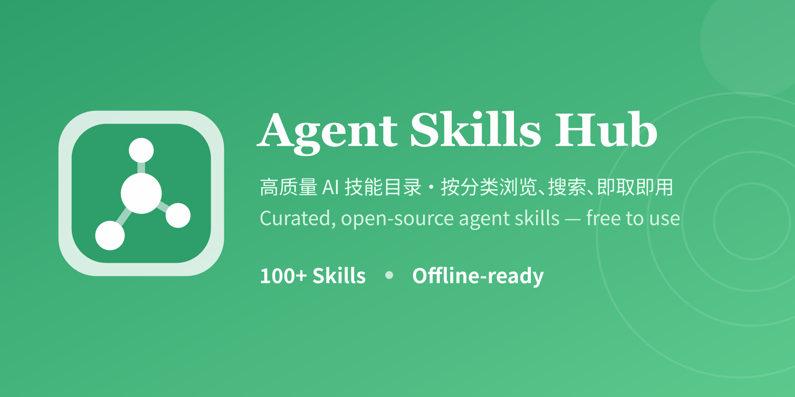

# Agent Skills Hub



[](CHANGELOG.md) [](LICENSE) [](https://github.com/sutchan/Agent-Skills-Hub/actions/workflows/ci.yml) [](README.md)

> Other languages: [中文文档](README.md)

**A centrally managed, browsable, and searchable catalog of AI agent skills** — spanning 14 domains with 169 skills (1 hidden), offering Chinese descriptions alongside English originals, ready to use for Chinese-speaking agent users.

## ✨ Features

- 🔍 **Search & filter**: filter and search skills by domain, keyword, and tag in real time
- ⭐ **Vote & favorite**: vote and bookmark your most-used / most-promising skills, and sort by popularity
- 🌐 **Bilingual**: ready out of the box for Chinese users, with English originals in `en_description`
- 📦 **One-click install**: copy `skills/<name>/`, or use [skills-manager](https://github.com/xingkongliang/skills-manager) for batch management
- 🧩 **Standardized spec**: based on `SKILL.md` (`name`/`description`/`category`, etc.); skills auto-trigger via `description`
- 📊 **Pure static site**: `output: "export"` static export, wired for EdgeOne Pages / GitHub Pages — easy to deploy

## 📊 Scale

| Metric | Value |
|---|---|
| Total skills | 169 (1 hidden) |
| Visible skills | 168 |
| Categories | 14 (13 currently active) |
| License | MIT overall (per-skill licenses in each dir) |

## 🚀 Quick Start

> Just want to use a skill? No build scripts needed.

1. **Browse skills**: run the local server and visit the site, then filter by domain to explore skills.
2. **Install**: copy the whole `skills/<name>/` directory into your agent's skills path (e.g. Claude Code's `~/.claude/skills/`).
3. **Trigger**: skills auto-trigger via the `description` in `SKILL.md`, or invoke explicitly with `@skill-name`.
4. **Check dependencies**: some skills need `scripts/` or external tools — read the skill's `SKILL.md` first.

## 📂 Directory Structure

```
Agent-Skills-Hub/
├── skills/            # Skill directories (one subdir per skill, with SKILL.md)
├── src/index.html     # High-fidelity prototype / site frontend (single-file inline)
├── server/            # Local preview server modules (config/fs-util/store/ratelimit/api/pages)
├── server.js          # Local preview server entry (Express, thin assembly)
├── data/              # skills-data.json (source of truth) / skills-metrics.json (derived)
├── scripts/           # sync-inline-data.mjs (inline sync) / tag-release.mjs (tagging)
├── tools/             # check-version / ensure-lf / validate-skills / extract-release-notes
├── e2e/               # Playwright smoke tests
├── docs/              # spec.md / tasks.md / tasks-done.md
└── .github/           # CI workflows and contributing guide
```

## Local Preview

The repo is a static site served by `server.js` (Express):

```bash
npm install
npm run dev      # start the server, default http://localhost:3000
```

Skill data is maintained in `data/skills-data.json` (stable metadata) and `data/skills-metrics.json` (derived metrics), and synced into `src/index.html`'s inline `window.SKILLS_DATA` via `npm run sync:data` to keep the UI consistent with the source of truth.

## Installation

### Option A: Manual copy

Copy the whole `skills/<name>/` directory into your agent's skills path (e.g. Claude Code's `~/.claude/skills/`, Windows: `%USERPROFILE%\.claude\skills\`; for CodeBuddy see client docs). Skills auto-trigger via the `description` in `SKILL.md`.

### Option B: Install & manage with skills-manager

We recommend [skills-manager](https://github.com/xingkongliang/skills-manager) for batch install/update/uninstall:

```bash
git clone https://github.com/sutchan/Agent-Skills-Hub.git
cd Agent-Skills-Hub
# import/link skills from skills/ into your agent via skills-manager
```

## Contributing

- New skills: use the built-in [`skill-creator`](skills/skill-creator/) skill to create and evaluate per guidelines.
- Name skill directories in `kebab-case`, matching the frontmatter `name`.
- `SKILL.md` required fields: `name`, `description` (zh), `en_description` (en), `zh_displayName`, `category`, `en_category`.
- Details in [CONTRIBUTING.md](.github/CONTRIBUTING.md).

## License

Per-skill licenses are in each directory's `LICENSE` file (e.g. [`skill-creator/LICENSE.txt`](skill-creator/LICENSE.txt)). The project itself is [MIT](LICENSE).

## Related Documents

- [Changelog](CHANGELOG.md) · [Contributing](.github/CONTRIBUTING.md) · [中文文档](README.md)
- Repository: https://github.com/sutchan/Agent-Skills-Hub
- Live site: https://skills.ewuse.com

## Environment Variables (Deployment)

The site is a pure static export (`output: "export"` in `next.config.mjs`). The Google Analytics 4 measurement ID is **no longer hard-coded** and is injected via the `GA_MEASUREMENT_ID` environment variable at deploy time:

| Variable | Description | Required | Default |
|---|---|---|---|
| `GA_MEASUREMENT_ID` | GA4 measurement ID (e.g. `G-XXXXXXXXXX`) | No (falls back to `G-WQDDVB14PF`) | `G-WQDDVB14PF` |

- **GitHub Actions build**: add `GA_MEASUREMENT_ID` (your GA4 ID) under repo **Settings → Variables**. The `build` job injects it, and `scripts/inject-ga.mjs` writes it into `out/index.html` at build time.
- **EdgeOne Pages build** (if using platform build instead of deploy-only): set the same `GA_MEASUREMENT_ID` in the EdgeOne project environment variables.
- **Local preview**: `server.js` reads `process.env.GA_MEASUREMENT_ID` directly, falling back to the default when unset — local GA is unaffected.
