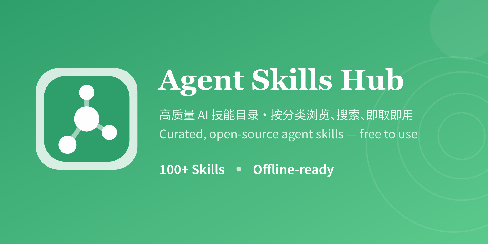

# Agent Skills Hub



[](CHANGELOG.md) [](LICENSE) [](README.md)

> Other languages: [中文文档](README.md)

A centrally managed collection of AI skills spanning multiple domains. Each skill is a standalone directory containing `SKILL.md` (description + trigger metadata via frontmatter) plus optional `scripts/`, `references/`, `assets/`, `agents/` resources. The repo is localized with Chinese categories and descriptions, while English originals live in `en_description` — ready to use for Chinese-speaking agent users.

## Quick Start

> Just want to use a skill? No build scripts needed.

1. **Browse skills**: run the local server and visit the site, then filter by domain to explore skills.
2. **Install**: copy the whole `skills/<name>/` directory into your agent's skills path (e.g. Claude Code's `~/.claude/skills/`).
3. **Trigger**: skills auto-trigger via the `description` in `SKILL.md`, or invoke explicitly with `@skill-name`.
4. **Check dependencies**: some skills need `scripts/` or external tools — read the skill's `SKILL.md` first.

## Local Preview

The repo is a static site served by `server.js` (Express):

```bash
npm install
npm run dev      # start the server, default http://localhost:3000
```

Skill data is maintained in `data/skills-data.json` (stable metadata) and `data/skills-metrics.json` (derived metrics), and inlined into the self-contained page.

## Installation

### Option A: Manual copy

Copy the whole `skills/<name>/` directory into your agent's skills path (e.g. Claude Code's `~/.claude/skills/`, Windows: `%USERPROFILE%\.claude\skills\`; for CodeBuddy see client docs). Skills auto-trigger via the `description` in `SKILL.md`.

### Option B: Install & manage with skills-manager

We recommend [skills-manager](https://github.com/xingkongliang/skills-manager) for batch install/update/uninstall:

```bash
git clone https://github.com/sutchan/Agent-Skills-Hub.git
cd Agent-Skills-Hub
# import/link skills from skills/ into your agent via skills-manager
```

## Contributing

- New skills: use the built-in [`skill-creator`](skills/skill-creator/) skill to create and evaluate per guidelines.
- Name skill directories in `kebab-case`, matching the frontmatter `name`.
- `SKILL.md` required fields: `name`, `description` (zh), `en_description` (en), `zh_displayName`, `category`, `en_category`.
- Details in [CONTRIBUTING.md](.github/CONTRIBUTING.md).

## License

Per-skill licenses are in each directory's `LICENSE` file (e.g. [`skill-creator/LICENSE.txt`](skill-creator/LICENSE.txt)). The project itself is [MIT](LICENSE).

## Related Documents

- [Changelog](CHANGELOG.md) · [Contributing](.github/CONTRIBUTING.md) · [中文文档](README.md)
- Repository: https://github.com/sutchan/Agent-Skills-Hub
