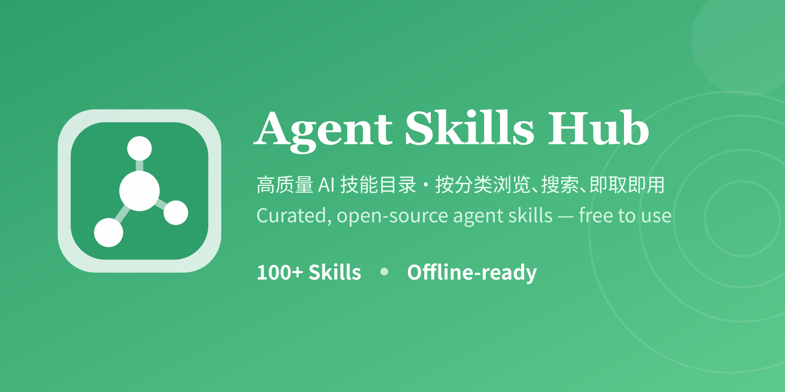

# Agent Skills Hub



[](CHANGELOG.md) [](LICENSE) [](https://github.com/sutchan/Agent-Skills-Hub/actions/workflows/ci.yml) [](README.en.md)

> 其他语言：[English](README.en.md)

**一个集中管理、可浏览、可检索的 AI Agent 技能目录** —— 覆盖 14 大领域、168 个技能（含 1 个隐藏），提供中文描述与英文原文，中文用户开箱即用。

## ✨ 特性

- 🔍 **检索与筛选**：按领域、关键词、标签实时筛选、搜索技能
- ⭐ **投票与收藏**：为常用 / 看好的技能投票、收藏，并查看热度排序
- 🌐 **中英双语**：中文用户开箱即用，英文原文存于 `en_description`
- 📦 **一键安装**：复制 `skills/<name>/` 目录，或用 [skills-manager](https://github.com/xingkongliang/skills-manager) 批量管理
- 🧩 **标准化规范**：基于 `SKILL.md`（`name`/`description`/`category` 等），技能靠 `description` 自动触发
- 📊 **纯静态站点**：`output: "export"` 纯静态导出，已对接 EdgeOne Pages / GitHub Pages，部署简单

## 📊 规模

| 指标 | 数值 |
|---|---|
| 技能总数 | 168（含 1 个隐藏） |
| 可见技能 | 167 |
| 分类 | 14 类（当前活跃 13 类） |
| 许可证 | 整体 MIT（各技能许可证见其目录） |

## 🚀 快速开始

> 只想用技能？无需碰任何构建脚本。

1. **浏览技能**：运行本地服务后访问站点，按领域筛选查看技能。
2. **安装技能**：把 `skills/<name>/` 整个目录复制到你的 Agent 技能目录（如 Claude Code 的 `~/.claude/skills/`）。
3. **触发使用**：技能靠 `SKILL.md` 的 `description` 自动触发，也可在对话中显式 `@技能名` 调用。
4. **查看依赖**：部分技能依赖 `scripts/` 脚本或外部工具，使用前先读对应 `SKILL.md`。

## 📂 目录结构

```
Agent-Skills-Hub/
├── skills/            # 技能目录（每个技能一个子目录，含 SKILL.md）
├── src/index.html     # 高保真原型 / 站点前端（单文件内联）
├── server.js          # 本地预览静态服务（Express）
├── data/              # skills-data.json（权威元数据）/ skills-metrics.json（派生指标）
├── scripts/           # sync-inline-data.mjs（内联数据同步）/ tag-release.mjs（打 tag）
├── tools/             # check-version / ensure-lf / validate-skills / extract-release-notes
├── e2e/               # Playwright 冒烟测试
├── docs/              # spec.md / tasks.md / tasks-done.md
└── .github/           # CI 工作流与贡献指南
```

## 本地预览

仓库为纯静态站点，由 `server.js`（Express）提供预览服务：

```bash
npm install
npm run dev      # 启动静态服务，默认 http://localhost:3000
```

技能数据维护于 `data/skills-data.json`（稳定元数据）与 `data/skills-metrics.json`（派生指标）。改完数据后运行 `npm run sync:data` 将最新技能同步进 `src/index.html` 的内联 `window.SKILLS_DATA`，保持前端展示与权威数据一致。

## 安装方式

### 方式 A：手动复制

将 `skills/<name>/` 整个目录复制到你的 Agent 技能目录（如 Claude Code 的 `~/.claude/skills/`，Windows：`%USERPROFILE%\.claude\skills\`；CodeBuddy 参考客户端文档）。技能通过 `SKILL.md` 的 `description` 自动触发。

### 方式 B：skills-manager 一键管理

推荐使用 [skills-manager](https://github.com/xingkongliang/skills-manager) 批量安装、更新与卸载：

```bash
git clone https://github.com/sutchan/Agent-Skills-Hub.git
cd Agent-Skills-Hub
# 按 skills-manager 文档将 skills/ 导入/链接到你的 Agent
```

## 贡献指南

- 新增技能：使用内置 [`skill-creator`](skills/skill-creator/) 技能按规范创建与评估。
- 目录命名用小写中划线（`kebab-case`），且与 frontmatter `name` 一致。
- `SKILL.md` 必备字段：`name`、`description`(中)、`en_description`(英)、`zh_displayName`、`category`、`en_category`。
- 详细规范见 [CONTRIBUTING.md](.github/CONTRIBUTING.md)。

## 许可证

各技能许可证见其目录内 `LICENSE` 文件（如 [`skill-creator/LICENSE.txt`](skill-creator/LICENSE.txt)）。项目整体采用 [MIT](LICENSE) 协议。

## 相关文档

- [变更记录](CHANGELOG.md) · [贡献指南](.github/CONTRIBUTING.md) · [英文文档](README.en.md)
- 项目地址：https://github.com/sutchan/Agent-Skills-Hub
- 在线站点：https://skills.ewuse.com

## 环境变量（部署）

站点为纯静态导出（`next.config.mjs` 的 `output: "export"`），Google Analytics 4 衡量 ID **不再硬编码**，改由部署平台环境变量 `GA_MEASUREMENT_ID` 注入：

| 变量 | 说明 | 必填 | 默认 |
|---|---|---|---|
| `GA_MEASUREMENT_ID` | GA4 衡量 ID（形如 `G-XXXXXXXXXX`） | 否（未设置时回退 `G-WQDDVB14PF`） | `G-WQDDVB14PF` |

- **GitHub Actions 构建**：在仓库 **Settings → Variables** 新增 `GA_MEASUREMENT_ID`（值为你的 GA4 ID）。`build` job 已将其注入构建环境，`scripts/inject-ga.mjs` 在构建期写入 `out/index.html`。
- **EdgeOne Pages 构建**（若改用平台构建而非仅部署）：在 EdgeOne 项目环境变量中设置同名 `GA_MEASUREMENT_ID` 即可。
- **本地预览**：`server.js` 直接读取 `process.env.GA_MEASUREMENT_ID` 注入，未设置时回退默认值，本地 GA 不受影响。
